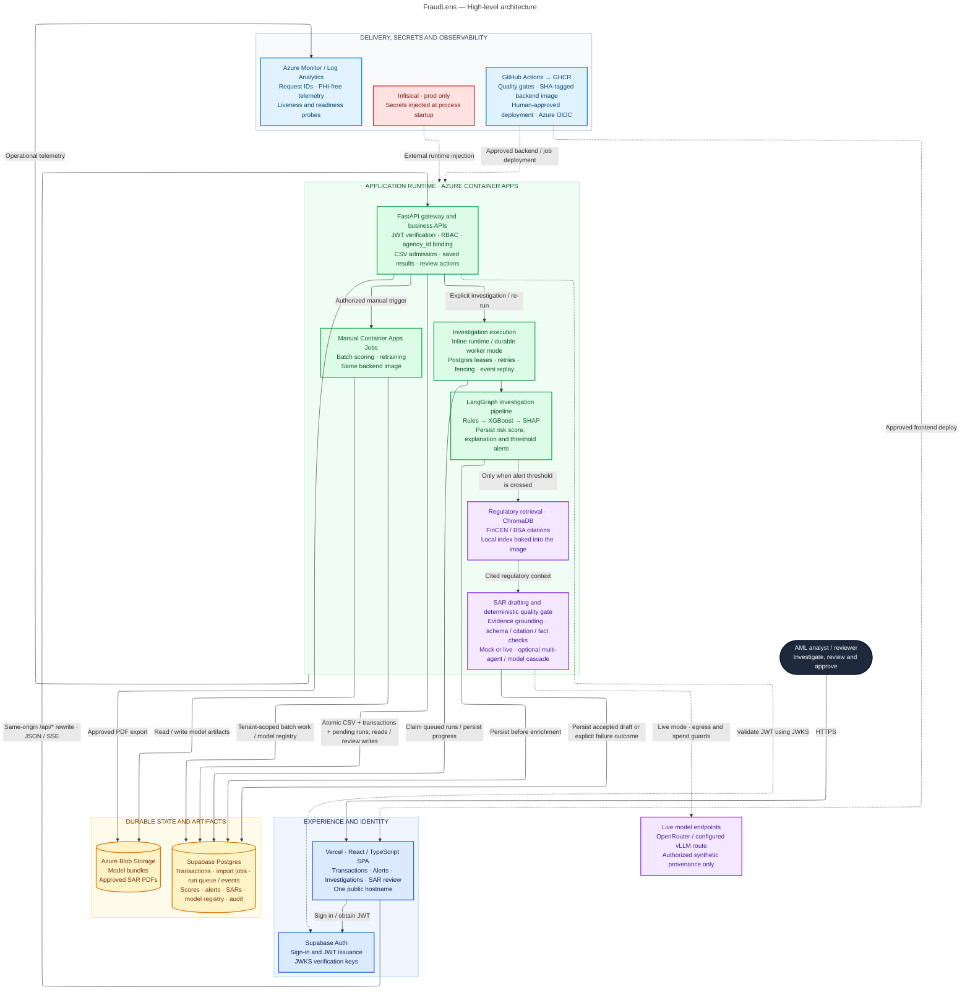

# FraudLens — High-level architecture

This view describes the current working tree, including the CSV-screening changes on
`codex/csv-screening-actions`. It is a code-and-configuration view, not a verification of the
currently deployed revision. The Mermaid source is the repository's canonical diagram; the
editable draw.io presentation shows the same components and relationships using native shapes,
a wider layout, and a light canvas through the project's official draw.io MCP server.

Blue identifies experience and identity; green identifies application compute; purple identifies
retrieval and drafting; amber identifies durable state; red identifies secret delivery. Solid
arrows show requests or data. Dashed arrows show trust, delivery, injection, or explicitly
conditional provider access; their labels distinguish these relationships.

- CSV acceptance atomically persists transactions and pending investigations. The durable queue
  is in Postgres. Inline mode supervises an upload worker within the API lifespan; worker mode
  uses a separate process. Container Apps Jobs are manual batch/retrain work, not this run queue.
- Below-threshold investigations stop after the persisted risk decision. Retrieval or drafting
  failure preserves the score and alert. Saved results return through the API; observation does
  not enqueue another run. Analysts must explicitly request a re-run.
- Live inference requires authorized persisted synthetic provenance. CSV/API-upload provenance
  is currently blocked from live drafting. Mock mode is keyless; live multi-agent routing also
  requires both process and tenant feature gates. A rejected draft is not served as accepted.
- Human review and approval remain explicit actions. A generated draft or approved PDF is not
  an automated filing to a regulator; no regulator integration is represented.
- All tenant business data and background work are scoped by verified `agency_id`. No real PHI
  is in scope. The application does not fetch secrets from Infisical itself.
- Production Terraform declares one warm API replica (`min_replicas = max_replicas = 1`).
  Kubernetes/AKS demonstrations and paid GPU experiments are ephemeral, not standing services
  in this topology. Optional vLLM routing does not imply a currently running GPU endpoint.

Evidence: [system architecture](ARCHITECTURE.md), [CSV-screening ADR](adr/ADR-031-atomic-upload-screening.md),
[durable execution ADR](adr/ADR-027-durable-investigation-execution.md),
[quality-gated drafting ADR](adr/ADR-030-quality-gated-sar-model-cascade.md),
[screening runbook](../runbooks/transaction-screening.md),
[pipeline wiring](../../backend/src/fraudlens_backend/pipeline_wiring.py),
[pipeline graph](../../packages/fraudlens-ml/src/fraudlens_ml/pipeline/graph.py),
[production configuration](../../config/prod.yaml),
[production Terraform](../../infra/terraform/environments/prod/main.tf),
[replica configuration](../../infra/terraform/environments/prod/prod.tfvars), and
[Vercel rewrites](../../frontend/vercel.json).
