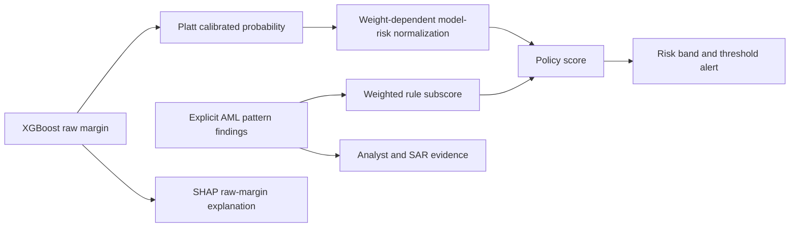

# Risk ranking and explicit AML findings — engineering review

- Date: 2026-10-26.
- Decision: retain the configurable **70/30** default and **0.60** cutoff for the current demo. Improve evidence labels and explicit rule findings. No deployment, retraining, mandatory rule override, or Git history change.
- Evidence status: **retrospective / exploratory**, with source-dependent results and an unresolved historical served-model metric discrepancy.
- [Aggregate artifact, hashes, configuration, daily slices and case exchanges](risk-ranking-review.json). [Decision: ADR-035](../../architecture/adr/ADR-035-risk-ranking-evidence-and-rule-findings.md). [Reproduction runbook](../../runbooks/risk-ranking-evaluation.md).

## What is actually served

An authorized, server-enforced read-only query of the Infisical `prod` database on 2026-10-26T22:19:17.918020+00:00 found active `xgb-ibm-aml-fs2-9d43c5f92a`, no canary, model weight `0.7`, alert threshold `0.6`, and band bounds `0 / 0.3 / 0.6 / 0.85`. The demo tenant has no rule overrides; global rule parameters and weights match the six defaults. Its latest recorded inference also names that HI-Small bundle. This identifies the observed registry/inference version; the running container file hash was not independently read.

The 6,358,506-row result used **`xgb-ibm-aml-hi-medium-5835992a6919`**, a different temporal-study model. It is not a measurement of the served HI-Small model. The locally evaluated booster and complete calibration metadata are separately hash-bound; the served bundle is unchanged.

## Scoring and application behavior

1. XGBoost produces a raw margin `m`. Persisted Platt parameters produce calibrated probability `p = sigmoid(a*m + b)`.
2. `RiskPolicy.model_risk` maps probability through persisted medium/high/critical operating points. With weight `w`, their target levels are the band bounds divided by `w`, clamped to `[0,1]` and made nondecreasing. Consequently, **changing the weight also changes normalization and clipping**.
3. The rules engine divides the sum of fired weights by the sum of enabled, successfully evaluated weights and quantizes the subscore to four decimals. The default denominator is `8.5`. Tenant definitions overlay global definitions, which overlay code defaults.
4. The policy score is `S = clip(w * modelRisk + (1-w) * ruleSubscore, 0, 1)`. The highest band whose lower bound is at most `S` wins; an alert is raised at `S >= 0.60` under the observed configuration.
5. At 70/30, model-only evidence contributes at most `0.70`, so CRITICAL at `0.85` requires rule contribution. This inherited band behavior is retained, not presented as a mandatory business-rule override or newly validated requirement.
6. Calibrated probability is persisted unchanged. SHAP explains the **raw model margin**; its signed values are not probability percentage points or parts of the combined policy score.
7. Application alert eligibility is threshold-based. The dashboard queue sorts severity then recency, and API lists use recency. The product does not dynamically select the top 5% of all transactions. The offline ranking study measures discrimination at a controlled workload, not full-application queue performance.

## Same-budget evidence

Every row within a comparison uses identical frozen probabilities and exactly `ceil(0.05*N)` alerts. Table counts use seeded, label-independent ties; expected recall averages over uniform boundary ties. Precision and recall describe laundering-labelled synthetic transactions, not SAR cases or real customer performance.

### hi-medium-study — research bundle

Model: `xgb-ibm-aml-hi-medium-5835992a6919`. Split: `temporal`. Evaluation rows: **6,358,506**; positives: **10,632**. Threshold provenance: `calibration`. Calibration selects model-only; that does not guarantee the same ordering on evaluation.

| Policy | Recall | Expected tie recall | Precision | Alerts | TP | FP |
|---|---:|---:|---:|---:|---:|---:|
| 50%/50% | 41.0083% | 41.0083% | 1.3714% | 317,926 | 4,360 | 313,566 |
| 60%/40% | 66.1588% | 65.8236% | 2.2125% | 317,926 | 7,034 | 310,892 |
| 70%/30% | 77.3796% | 77.3796% | 2.5877% | 317,926 | 8,227 | 309,699 |
| 80%/20% | 77.7652% | 77.7652% | 2.6006% | 317,926 | 8,268 | 309,658 |
| model-only | 77.8969% | 77.8969% | 2.6050% | 317,926 | 8,282 | 309,644 |

### hi-small-served — served bundle

Model: `xgb-ibm-aml-fs2-9d43c5f92a`. Split: `account_whole`. Evaluation rows: **1,010,875**; positives: **1,617**. Threshold provenance: `holdout`. Calibration selects model-only; that does not guarantee the same ordering on evaluation.

| Policy | Recall | Expected tie recall | Precision | Alerts | TP | FP |
|---|---:|---:|---:|---:|---:|---:|
| 50%/50% | 61.3482% | 61.2367% | 1.9626% | 50,544 | 992 | 49,552 |
| 60%/40% | 62.7087% | 62.8876% | 2.0062% | 50,544 | 1,014 | 49,530 |
| 70%/30% | 66.2338% | 66.2338% | 2.1189% | 50,544 | 1,071 | 49,473 |
| 80%/20% | 66.0482% | 66.0482% | 2.1130% | 50,544 | 1,068 | 49,476 |
| model-only | 65.1824% | 65.1824% | 2.0853% | 50,544 | 1,054 | 49,490 |

### hi-medium-served — served bundle

Model: `xgb-ibm-aml-fs2-9d43c5f92a`. Split: `temporal`. Evaluation rows: **6,358,506**; positives: **10,632**. Threshold provenance: `holdout`. Calibration selects model-only; that does not guarantee the same ordering on evaluation.

| Policy | Recall | Expected tie recall | Precision | Alerts | TP | FP |
|---|---:|---:|---:|---:|---:|---:|
| 50%/50% | 68.9052% | 68.9052% | 2.3043% | 317,926 | 7,326 | 310,600 |
| 60%/40% | 70.2972% | 70.2972% | 2.3509% | 317,926 | 7,474 | 310,452 |
| 70%/30% | 70.6358% | 70.6358% | 2.3622% | 317,926 | 7,510 | 310,416 |
| 80%/20% | 70.8616% | 70.8616% | 2.3697% | 317,926 | 7,534 | 310,392 |
| model-only | 71.1813% | 71.1813% | 2.3804% | 317,926 | 7,568 | 310,358 |

### li-medium-served — served bundle

Model: `xgb-ibm-aml-fs2-9d43c5f92a`. Split: `temporal`. Evaluation rows: **6,231,386**; positives: **3,781**. Threshold provenance: `holdout`. Calibration selects model-only; that does not guarantee the same ordering on evaluation.

| Policy | Recall | Expected tie recall | Precision | Alerts | TP | FP |
|---|---:|---:|---:|---:|---:|---:|
| 50%/50% | 52.0233% | 52.0233% | 0.6313% | 311,570 | 1,967 | 309,603 |
| 60%/40% | 54.1391% | 54.1391% | 0.6570% | 311,570 | 2,047 | 309,523 |
| 70%/30% | 54.5358% | 54.5358% | 0.6618% | 311,570 | 2,062 | 309,508 |
| 80%/20% | 55.0912% | 55.0912% | 0.6685% | 311,570 | 2,083 | 309,487 |
| model-only | 55.8053% | 55.8053% | 0.6772% | 311,570 | 2,110 | 309,460 |

## Cases gained and lost

At the same global review budget, model-only exchanges the following positive cases against 70/30. A net gain can coexist with losing specific pattern-bearing positives.

| Source / bundle | Gained positives | Lost positives | Net |
|---|---:|---:|---:|
| hi-medium-study | 129 | 74 | +55 |
| hi-small-served | 9 | 26 | -17 |
| hi-medium-served | 172 | 114 | +58 |
| li-medium-served | 101 | 53 | +48 |

For the served HI-Small replay, the 26 lost positives contain 18 rapid-movement, 10 velocity, 4 geography-proxy, 3 threshold-evasion and 1 structuring findings; patterns overlap. All 9 gained positives have no rule hit. In the HI-Medium research replay, all 129 gained positives likewise have no rule hit, while 74 pattern-bearing positives are lost. This is a concrete coverage tradeoff, not a finding that every rule improves ranking.

Rule findings remain useful as explicit, versioned observations: identify a matched predicate and time window, guide analyst inspection, and supply facts to the existing SAR evidence catalog. The seven-day structuring and 48-hour rapid-movement rules also express windows beyond the model’s 24-hour aggregate features. A matched pattern does not establish fraud; no mandatory override is introduced. IBM country is a currency-derived proxy, so geography results are not validation against real jurisdiction data.

## Time consistency

The following counts compare separately budgeted UTC days; they are not a partition of the global-budget TP difference. Days and accounts are correlated, and no statistical-significance claim is made.

| Source / bundle | Days model-only wins | Ties | Days model-only loses |
|---|---:|---:|---:|
| hi-medium-study | 10 | 5 | 0 |
| hi-small-served | 5 | 5 | 5 |
| hi-medium-served | 11 | 4 | 0 |
| li-medium-served | 9 | 5 | 0 |

## Later chronological period

The actual HI-Small training allocation ends at **2022-09-18 16:18 UTC**. The Medium sources extend to September 28 (HI) and September 27 (LI). An earlier investigation statement that no later period existed was incorrect; the protocol records the correction. These later rows were already included in inspected aggregate comparisons, so this is a **retrospective out-of-time slice**, not a new blind trial. No new parameter is selected on this slice.

| Source, served bundle | Rows | Positive prevalence | Reviews | Policy | Recall | Expected tie recall | Precision | TP | FP |
|---|---:|---:|---:|---|---:|---:|---:|---:|---:|
| hi-medium-served | 3,759 | 58.13% | 188 | 70%/30% | 6.682% | 6.623% | 77.660% | 146 | 42 |
| hi-medium-served | 3,759 | 58.13% | 188 | 80%/20% | 6.819% | 6.740% | 79.255% | 149 | 39 |
| hi-medium-served | 3,759 | 58.13% | 188 | model-only | 8.467% | 8.467% | 98.404% | 185 | 3 |
| li-medium-served | 754 | 55.57% | 38 | 70%/30% | 6.683% | 6.818% | 73.684% | 28 | 10 |
| li-medium-served | 754 | 55.57% | 38 | 80%/20% | 6.683% | 7.001% | 73.684% | 28 | 10 |
| li-medium-served | 754 | 55.57% | 38 | model-only | 9.069% | 9.069% | 100.000% | 38 | 0 |

Model-only ranks this tail better, but these very small tails are heavily enriched with positive labels (over 55%), unlike the main evaluation base rates. At a 5% review budget, even perfect selection cannot recover more positives than the available review slots. They demonstrate distribution shift and saturation/tie effects; they do not establish general production superiority.

## Fixed threshold and capacity

The existing cutoff is an eligibility policy, not a capacity guarantee. The separate calibration cutoff below is selected from the calibration ranking boundary and then frozen; all ties at that cutoff are included. Its later workload can drift substantially.

| Served bundle on source | Policy | Current 0.60 alerts | Current alert rate | Calibration cutoff | Later alerts at calibration cutoff | Later alert rate |
|---|---|---:|---:|---:|---:|---:|
| hi-small-served | 70%/30% | 56,144 | 5.554% | 0.403192 | 103,113 | 10.200% |
| hi-small-served | model-only | 54,572 | 5.398% | 0.363003 | 111,713 | 11.051% |
| hi-medium-served | 70%/30% | 163,277 | 2.568% | 0.450852 | 344,301 | 5.415% |
| hi-medium-served | model-only | 142,795 | 2.246% | 0.405377 | 341,995 | 5.379% |
| li-medium-served | 70%/30% | 150,276 | 2.412% | 0.447079 | 331,941 | 5.327% |
| li-medium-served | model-only | 131,049 | 2.103% | 0.401349 | 330,477 | 5.303% |

Changing to weight one preserves a monotonic model-only ordering under its own normalization, but also changes band behavior and the raw probability that corresponds to a policy cutoff. It is not equivalent to comparing raw probability against 0.60. No band or threshold is changed by this review.

## Verification and remaining limitations

- The original four-weight HI-Medium recall, precision, TP, FP and alert counts reproduce exactly. Its original report/JSON are unchanged. The original scripts are archived byte-for-byte, and both old source hashes match the original artifact.
- Input CSV hashes, feature/label/fold bytes, booster bytes, complete calibration metadata and cached prediction bytes are bound. The canonical scalar `RiskPolicy.assess` checks sampled vector results. A fixed-70/30-normalization sensitivity is included per policy in the JSON.
- Every holdout-positive case is independently replayed through `RuleRegistry` using strictly earlier, bounded account histories. Sampled feature parity covers 100 rows per source; maximum absolute errors are hi-medium: `9.23705556488e-12`, hi-small: `1.40873979149e-11`, li-medium: `5.70565816815e-12` (all below `1e-9`).
- **The original served HI-Small metadata recall does not reproduce exactly:** it records 64.7495% (1,047 positives at this fold’s denominator), while the current live-compatible replay produces 65.1824% (1,054). Current sampled feature parity passes, model bytes and metadata are verified, and fold sizes/positive counts reconcile. The exact historical fit-time feature/prediction artifacts are not present in the inspected local inputs, so the seven-case discrepancy remains unresolved. The original number is preserved, and the current replay is labelled separately.
- The served bundle’s missing `threshold_source` field is interpreted as historical `holdout` by the compatibility loader, as specified in ADR-025. The newer study bundle records calibration-derived operating points. Neither probability calibration nor operating points are re-fit here.
- The earlier HI-Medium holdout informed the model-only hypothesis. The served model uses an account-whole split with calendar overlap. The later-period correction does not create a blind final test. All reported comparisons remain exploratory.
- No cluster-aware confidence interval, independent future deployment cohort, live container file-hash inspection, or production shadow rollout is claimed. Small TP differences are observed counts, not proof of statistical superiority.
- Runtime observations are a dated read-only snapshot of the demo’s global policy and effective default rules. Other tenants can override rules, so these measurements do not validate every full-application configuration.

## Implemented result

- Retain the default policy and cutoff; preserve all original model and experiment artifacts.
- Add committed configuration, a provider-free evaluation runner, hash-bound reusable predictions, calibration-first selection records, daily slices, rule-pattern exchanges, threshold workload checks and a separate study coverage gate.
- Show calibrated probability separately from policy score, describe SHAP as raw-margin explanation, and render named rule findings in both investigation and saved-alert review. Clarify the existing API schema descriptions without changing field names.
- Preserve tenant isolation, authorization, immutable human review and SAR grounding/egress contracts. Desktop and 400-pixel saved-evidence views were checked using the read-only synthetic auditor.

## Original local verification

| Check | Result |
|---|---|
| `make backend-coverage` | 2,407 passed; 25 skipped; 25 deselected; 96.09% measured coverage with branches enabled |
| `make frontend-coverage` | 487 passed across 77 files; 90.91% branch coverage |
| `make risk-study-test` | 41 passed; 98.71% measured coverage with branches enabled |
| `make quality-gates` | 33 deterministic citation, hallucination and model-egress checks passed |
| Lint, format, type, header, file-length, documentation, hardcoding, tenancy and duplication gates | Passed; two existing class-order warnings in `AlertQueue.tsx` |
| Browser review | Desktop and 400-pixel synthetic saved evidence; distinct probability/score, SHAP units and named rules |

The backend skips include infrastructure-dependent tests; this is not a claim that a new deployed
application or external provider was exercised. Focused pipeline, SAR, API streaming and tenant
isolation tests also passed. No deployment or cloud mutation was performed.

## Release extraction verification — 2026-10-28

The risk explanations, published evidence and offline study harness are extracted onto
`codex/risk-evidence-and-rule-findings` from `origin/release/0.7.0` at
`651e3bb3034655539760eef170dbb288523af1fb`, including the merged maker–checker workflow.
Semantic retrieval changes remain separate. The study coverage target now runs in both `make ci`
and the shared GitHub quality job whenever the backend is in scope.

| Extraction check | Result |
|---|---|
| `make pre-pr` | Complete canonical gate passed. Frontend lint, format, typechecking and coverage were repeated after adding the missing-score state tests. |
| Backend suite | 2,407 passed; 25 skipped; 25 deselected; 96.28% branch-aware coverage. |
| Final frontend suite | 489 passed across 78 files; 96.87% statements, 91.10% branches, 97.41% lines. |
| `make risk-study-test` | 41 passed; 98.71% branch-aware study coverage, including archived-source hashes and published-count reconciliation. |
| Changed-line coverage | Backend 100%; frontend 100% versus the merged release base, including newly added components. Missing-score and probability-only states preserve named findings and truthful labels. |
| Synthetic baseline and browser | Fresh baseline verified with 20 transactions and 15 scored runs; the read-only Auditor inspected saved case evidence and Investigation risk/drivers. Desktop width 1280 and mobile width 400 matched document/body widths; keyboard progression worked. |
| Teardown | Extraction-only PostgreSQL container and API/frontend listeners removed; original local services preserved. |

The failed-SAR case test also verifies that score/probability explanations, SHAP units and named
rule findings remain visible. The frozen serving bundle, 70/30 default, 0.60 threshold and synthetic
scoring expectations remain unchanged. Published full-data comparisons above remain dated evidence;
this extraction reran portable gates and synthetic UAT without a new full-data replay or training.
Local logs, API evidence and screenshots are gitignored under
`.local/verification/risk-evidence-release-070/` in the extracted checkout.

## 60-second interview answer

> “70/30 began as a configurable heuristic, not an experimentally optimal split. I later compared it with other blends and model-only ranking at the same review budget. The first HI-Medium study slightly favored model-only, but that was a different model from the deployed HI-Small bundle. I verified the active version and replayed both. On the served model’s own source, 70/30 detected 1,071 positives versus 1,054 for model-only; model-only gained nine cases and lost twenty-six. Results varied across sources and time, and the fixed alert threshold did not enforce the same workload. I retained the demo default, made the comparison reproducible, and kept rules as explicit investigation and SAR evidence with clear probability and SHAP labels. A policy change needs an appropriately predeclared future evaluation, not a claim that these later experiments justified the original heuristic.”
